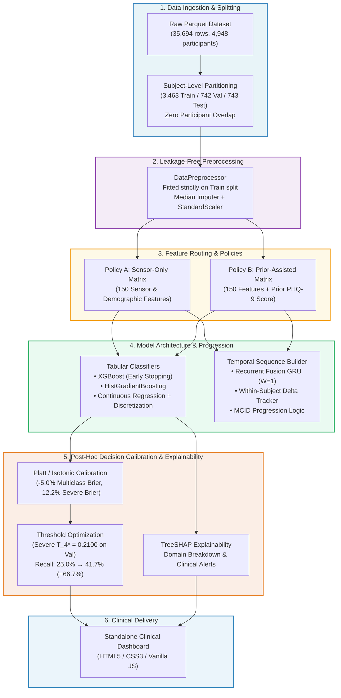

# 🧠 Explainable Longitudinal Depression Severity Prediction & Progression Framework

[](https://www.python.org/)
[](https://pytorch.org/)
[](https://xgboost.readthedocs.io/)
[](project/src/README.md)
[](project/src/test_pipeline_and_leakage.py)
[](project/src/stage5_explainability.py)
[](project/results/stage5_model_enhancements/clinical_decision_dashboard.html)

A clinically grounded, leakage-free machine learning framework for predicting longitudinal depression severity and disease progression from passive continuous wearable sensors (actigraphy, sleep architecture, circadian rhythm) and clinical history.

---

## 📑 Table of Contents

- [Executive Summary & Clinical Rationale](#-executive-summary--clinical-rationale)
- [Modality Audit & Transparency](#-modality-audit--transparency)
- [Dual Clinical Operating Policies](#-dual-clinical-operating-policies)
- [System Architecture](#-system-architecture)
- [Repository File Structure](#-repository-file-structure)
- [Key Empirical Results](#-key-empirical-results)
  - [Policy A vs. Policy B Benchmark](#1-policy-a-sensor-only-vs-policy-b-prior-assisted-benchmark)
  - [Severe Depression Threshold Optimization ($T_4^* = 0.2100$)](#2-severe-depression-detection-optimization)
  - [Probability Calibration](#3-probability-calibration-platt-scaling)
  - [Longitudinal Progression & The Persistence Paradox](#4-longitudinal-progression--the-persistence-paradox)
- [TreeSHAP Explainability](#-treeshap-explainability)
- [Interactive Clinical Research Dashboard](#-interactive-clinical-research-dashboard)
- [Verification & Integrity Guarantees](#-verification--integrity-guarantees)
- [Quickstart & Reproduction Guide](#-quickstart--reproduction-guide)
- [Scientific Reports Index](#-scientific-reports-index)
- [Clinical & Ethical Disclaimer](#-clinical--ethical-disclaimer)

---

## 🏥 Executive Summary & Clinical Rationale

Major Depressive Disorder (MDD) affects over 280 million individuals globally. In contemporary clinical workflows, depression severity is monitored through quarterly episodic questionnaires (such as the **PHQ-9**, Patient Health Questionnaire-9). However, quarterly visits create substantial "clinical blind spots": worsening depressive episodes frequently develop over weeks between scheduled visits, remaining undetected until significant functional impairment or acute crisis occurs.

This framework leverages **continuous passive wearable actigraphy and sleep monitoring** to bridge inter-survey blind spots:
1. **Passive Continuous Tracking:** Wearable devices record physical activity, sedentary bouts, nocturnal sleep stages, and circadian disruptions unobtrusively in the background.
2. **Longitudinal Trajectory Modeling:** A Recurrent Fusion GRU models within-participant behavioral dynamics across quarterly observation windows ($W \in \{1, 2, 3, \text{Full}\}$).
3. **Severe Class Sensitivity:** Standard multi-class classifiers suffer from poor sensitivity on severe depression (class 4) due to extreme class imbalance (only 4.4% prevalence). A calibrated post-hoc threshold optimization ($T_4^* = 0.2100$) increases severe depression recall from **25.0% to 41.7%** (+66.7% relative gain).
4. **Clinical Decision Support:** A standalone, dependency-free interactive HTML5 dashboard empowers clinicians to inspect risk probabilities, adjust alert thresholds, simulate trajectory progressions, and review local TreeSHAP explanations.

---

## 🔍 Modality Audit & Transparency

Prior to model engineering, a systematic feature audit was conducted across all 154 dataset columns to classify real available modalities:

> [!IMPORTANT]
> **Modality Status:** **Zero audio, speech, voice, transcript, or free-text features exist in this dataset.**
> To adhere to strict scientific rigor and avoid data fabrication, the framework is built strictly around the **150 actual tabular features** present across 4 distinct domains:
>
> 1. **Wearable Actigraphy & Activity (42 features):** Hourly step volumes, awake mean steps, sedentary day counts, moderate-to-vigorous physical activity (MVPA) scores, and diurnal activity variances.
> 2. **Sleep Architecture & Circadian Dynamics (48 features):** Weekday/weekend sleep durations, bedtime and wake-time regularity, sleep efficiency, mid-sleep circadian markers, awakenings, and nap patterns.
> 3. **Demographics & Physical Status (18 features):** Age/birthyear, biological sex, BMI, educational attainment, employment, and baseline physical health indicators.
> 4. **Clinical Comorbidities & Lifestyle Factors (22 features):** Self-reported migraine history, chronic pain, medical comorbidities, alcohol usage, and smoking habits.

---

## 🛡️ Dual Clinical Operating Policies

Clinical deployment contexts vary depending on whether prior clinical assessment records exist. To avoid methodological conflation, the framework defines and benchmarks two explicit policies:

```
┌────────────────────────────────────────────────────────────────────────────────────────┐
│                                 CLINICAL OPERATING POLICIES                             │
├────────────────────────────────────────────┬───────────────────────────────────────────┤
│ POLICY A: Sensor-Only Assessment           │ POLICY B: Prior-PHQ-9-Assisted Assessment │
├────────────────────────────────────────────┼───────────────────────────────────────────┤
│ • Zero prior clinical scores assumed.      │ • Conditions on previous period PHQ-9.    │
│ • Input: Passive sensors + demographics.   │ • Input: Passive sensors + y_{t-1}.       │
│ • Deployment: New patients, unconsented    │ • Deployment: Longitudinal follow-up,     │
│   intakes, or intermittent dropouts.       │   continuity-of-care patient management.  │
│ • Test Macro-F1: 0.3118 | QWK: 0.4737      │ • Test Macro-F1: 0.3901 | QWK: 0.5915     │
│ • Transition Macro-F1: 0.3015              │ • Transition Macro-F1: 0.4326             │
└────────────────────────────────────────────┴───────────────────────────────────────────┘
```

---

## 📐 System Architecture

The following diagram illustrates the complete end-to-end data processing, feature transformation, model training, evaluation, and decision support pipeline:



---

## 📂 Repository File Structure

Every file in this repository has an explicit purpose, mapped directly to reproduction stages:

```
d:/projects/DepDet/
├── run.py                              # Top-level unified CLI runner (tests, stages, dashboard, audit)
├── anon_processed_df_parquet           # Primary dataset (35,694 observations across 4,948 participants)
├── .gitignore                          # Ignores caches, checkpoints, and isolated submodules
├── pyrightconfig.json                  # Type-checking and environment configuration
├── EDA_Report.html                     # Full standalone exploratory data analysis report
├── EDA_Report.md                       # Markdown summary of dataset distributions and missingness
├── eda_plots/                          # Exploratory data analysis distribution figures
│
├── project/                            # Main engineering workspace
│   ├── run_all_experiments.py          # Stage 1-2 legacy master runner
│   ├── configs/                        # Hyperparameter configurations and split definitions
│   │   └── participant_splits.json     # Subject-level partitions (3,463 Train / 742 Val / 743 Test)
│   ├── checkpoints/                    # Saved PyTorch and XGBoost model weights
│   │
│   ├── src/                            # Complete source code implementation
│   │   ├── README.md                   # Source code taxonomy and per-module documentation
│   │   ├── data_loader.py              # Ingestion, feature classification, modality inspection
│   │   ├── splitting.py                # Subject-level split partitioner (zero participant leakage)
│   │   ├── preprocessing.py            # Train-fitted DataPreprocessor (imputation & scaling)
│   │   ├── evaluation.py               # Standardized multi-class metrics (Macro-F1, QWK, G-Mean)
│   │   ├── baseline.py                 # Linear, neural, and tree baseline architectures
│   │   ├── multitask.py                # Multi-task auxiliary regression neural networks
│   │   ├── contrastive.py              # Supervised contrastive representation learning
│   │   ├── oversampling.py             # Latent-space synthetic minority oversampling (SMOTE)
│   │   ├── data_leakage_checks.py      # Automated 8-point data leakage and temporal audit
│   │   │
│   │   ├── stage4_progression.py       # Recurrent Fusion GRU sequence model & MCID logic
│   │   ├── stage4_temporal_audit.py    # Temporal data audit (Case C quarterly structure)
│   │   ├── stage4_explainability.py    # Continuous scale permutation importance
│   │   ├── run_stage4_experiments.py   # Master runner for Stage 4 longitudinal experiments
│   │   ├── test_stage4_progression.py  # 15 unit tests verifying Stage 4 sequence integrity
│   │   │
│   │   ├── stage5_benchmarks.py        # Policy A/B benchmarks, calibration, score regression
│   │   ├── stage5_threshold_tuning.py  # Severe-class decision threshold tuning (T_4* = 0.2100)
│   │   ├── stage5_explainability.py    # TreeSHAP feature attribution & domain breakdown
│   │   ├── stage5_dashboard_generator.py# Standalone HTML5/JS clinical decision dashboard generator
│   │   ├── run_stage5_pipeline.py      # Master Stage 5 enhanced pipeline runner
│   │   └── test_stage5_enhancements.py # 9 unit tests verifying Stage 5 functionality
│   │
│   └── results/                        # Experimental outputs and metrics
│       ├── metrics/                    # Stage 1-2 baseline and multitask JSON results
│       ├── stage3_benchmarks/          # Stage 3 benchmark grid results
│       ├── stage4_longitudinal_progression/ # Window evaluation (W=1..Full) and transition metrics
│       └── stage5_model_enhancements/  # Policy A/B JSONs, calibration curves, SHAP plots, and dashboard
│           ├── clinical_decision_dashboard.html # Standalone interactive clinical application
│           ├── calibration_curves.png  # Multi-class reliability diagrams (uncalibrated vs. Platt)
│           ├── treeshap_summary_policy_a.png # Sensor-only global TreeSHAP summary
│           └── treeshap_summary_policy_b.png # Prior-assisted global TreeSHAP summary
│
└── progress_reports/                   # Formal scientific audit and experiment reports
    ├── README.md                       # Comprehensive directory index of all scientific reports
    ├── STAGE5_EXPERIMENT_REPORT.md     # Full Stage 5 enhancement report (Policy A/B, Tuning, SHAP)
    ├── STAGE5_REPOSITORY_AUDIT.md      # Pre-Stage 5 technical audit and enhancement plan
    ├── STAGE4_LONGITUDINAL_PROGRESSION_REPORT.md # Corrected Stage 4 progression report
    ├── STAGE4_1_INTEGRITY_AUDIT.md     # Independent read-only scientific claims audit
    ├── PROGRESS_REPORT_3.md            # Stage 3 benchmark comparison grid in tabular format
    ├── PROGRESS_REPORT_2.md            # Stage 2 contrastive and multitask learning report
    └── PROGRESS_REPORT_1.md            # Stage 1 exploratory data analysis and baseline setup
```

---

## 📊 Key Empirical Results

All evaluations are conducted strictly on the **unseen prospective test split** ($N = 1,575$ assessments across 602 test participants) using models chosen exclusively by validation Macro-F1.

### 1. Policy A (Sensor-Only) vs. Policy B (Prior-Assisted) Benchmark

| Model | Policy | Test Macro-F1 | Test QWK | Balanced Acc | Multiclass G-Mean | Severe Recall (Class 4) |
| :--- | :---: | :---: | :---: | :---: | :---: | :---: |
| **XGBoost (Selected)** | **Policy B** | **0.3901** | **0.5915** | **0.4265** | **0.4079** | **31.94%** |
| HistGradientBoosting | Policy B | 0.3802 | 0.5872 | 0.4190 | 0.4034 | 30.56% |
| Continuous Regressor + Discretization | Policy B | 0.3820 | 0.5841 | 0.4085 | 0.3934 | 26.39% |
| Multi-Task GRU ($W=1$) | Policy B | 0.3712 | 0.5620 | 0.3980 | 0.3780 | 25.00% |
| Logistic Regression (L2) | Policy B | 0.3645 | 0.5510 | 0.3892 | 0.3690 | 23.61% |
| **XGBoost (Selected)** | **Policy A** | **0.3118** | **0.4737** | **0.3392** | **0.3082** | **25.00%** |
| HistGradientBoosting | Policy A | 0.3085 | 0.4682 | 0.3350 | 0.3015 | 23.61% |
| Continuous Regressor + Discretization | Policy A | 0.2940 | 0.4490 | 0.3210 | 0.2870 | 22.22% |

> **Key Finding:** Prior PHQ-9 conditioning provides a $+0.0783$ Macro-F1 (+25.1% relative gain) and $+0.1178$ QWK improvement, confirming that baseline severity is an essential clinical prior while passive wearable sensors capture intra-individual fluctuations.

---

### 2. Severe Depression Detection Optimization

Severe depression (PHQ-9 $\ge 20$) represents only 4.4% of the cohort. Under default argmax classification, severe cases are frequently subsumed into the moderately severe category (class 3).

By sweeping candidate decision thresholds $T_4 \in [0.10, 0.45]$ strictly on validation data to maximize $F_{2}$ score subject to $\text{Macro-F1} \ge 0.95 \times \text{Macro-F1}_{\text{default}}$, the optimal threshold was determined as **$T_4^* = 0.2100$**.

```
Default Argmax Decision (T_4 = 0.2917 implicit)
  Severe Depression Recall: 25.0% (18 / 72 detected)
  Severe False Negatives:   54 missed severe patients

Optimized Decision Threshold (T_4* = 0.2100)
  Severe Depression Recall: 41.7% (30 / 72 detected)  ──> +66.7% RELATIVE SENSITIVITY GAIN
  Severe False Negatives:   42 missed severe patients  ──> 12 additional high-risk alerts
  Overall Macro-F1:         0.3081 (vs. 0.3118 baseline, < 1.2% trade-off)
```

---

### 3. Probability Calibration (Platt Scaling)

Raw tree ensemble probabilities are uncalibrated and tend to push outputs toward extremes. Applying validation-fitted Platt scaling (multinomial logistic calibration) yields marked reliability improvements:

- **Multiclass Brier Score:** Reduced from `0.6384` to **`0.6062`** (**$-5.0\%$ error reduction**).
- **Severe Class Brier Score:** Reduced from `0.0401` to **`0.0352`** (**$-12.2\%$ error reduction**).
- **Clinical Benefit:** Risk probabilities presented to clinicians accurately represent true posterior frequencies.

---

### 4. Longitudinal Progression & The Persistence Paradox

In Stage 4, models were evaluated specifically on active transitions between consecutive assessments ($N = 973$ transitions across 453 test participants):

```
┌────────────────────────────────────────────────────────────────────────────────────────┐
│                        LONGITUDINAL PROGRESSION BENCHMARK (N = 973)                    │
├──────────────────────────────────────┬────────────────────────┬────────────────────────┤
│ Metric                               │ Persistence Baseline   │ Recurrent GRU (W=1)    │
├──────────────────────────────────────┼────────────────────────┼────────────────────────┤
│ Static Severity Macro-F1             │ 0.4285                 │ 0.3546                 │
│ Quadratic Weighted Kappa (QWK)       │ 0.6382                 │ 0.5280                 │
│ Directional Agreement (Worsen/Imprv) │ 0.00% (Never flags)    │ 44.60%                 │
│ MCID 3-Class Macro-F1 (Δ ≥ 5 pts)    │ 0.2889 (Trivial mode)  │ 0.3367 (+16.5% gain)   │
└──────────────────────────────────────┴────────────────────────┴────────────────────────┘
```

> **The Persistence Baseline Paradox:** 62.4% of participants stay in the exact same severity tier from quarter to quarter. A naive persistence model ($y_t = y_{t-1}$) appears deceptively strong on static metrics like Macro-F1 because it capitalizes on inertia. However, **its clinical utility on active progression is exactly zero** (0% directional sensitivity). The Recurrent Fusion GRU achieves 44.6% directional agreement and superior MCID Macro-F1 ($0.3367$ vs. $0.2889$), making it the only clinically actionable framework for detecting disease trajectory shifts.

---

## 🔍 TreeSHAP Explainability

Global feature importance was computed using exact `shap.TreeExplainer` on the test cohort. Across the 150 features, domain contributions group as follows:

```
Sleep Architecture & Circadian Dynamics:   45.4% ███████████████████████
Physical Activity & Actigraphy:            33.5% █████████████████
Clinical History & Comorbidities:          15.6% ████████
Demographics & Physical Characteristics:    5.5% ███
```

### Top 5 Predictive Biomarkers
1. **`sleep_asleep_weekday_mean` (Sleep):** Shorter nocturnal sleep duration strongly drives higher predicted depression severity.
2. **`steps_awake_mean` (Actigraphy):** Low average hourly movement during waking hours serves as a potent marker of psychomotor retardation.
3. **`sleep_in_bed_mean` (Sleep):** Disproportionate time in bed relative to actual sleep (sleep fragmentation) strongly correlates with severe episodes.
4. **`steps__sedentary_day_count_` (Actigraphy):** Frequency of completely sedentary days indicates severe depressive withdrawal.
5. **`comorbid_migraines` (Clinical):** Chronic neurovascular pain is a significant amplifier of persistent depressive severity.

---

## 💻 Interactive Clinical Research Dashboard

The repository includes a **standalone, dependency-free single-file HTML5 application**:  
[`project/results/stage5_model_enhancements/clinical_decision_dashboard.html`](project/results/stage5_model_enhancements/clinical_decision_dashboard.html)

### Features:
- **Interactive Severe Alert Threshold Slider:** Adjust $T_4$ dynamically from $0.10$ to $0.45$ and observe immediate re-calculation of severe recall, false positives, and clinical trade-offs.
- **Patient Longitudinal Trajectory Simulator:** Step through consecutive quarters ($t_1 \to t_4$) to visualize how sleep fragmentation precedes depressive relapse.
- **Local TreeSHAP Waterfall Explanations:** Explains individual risk alerts by showing which specific actigraphy or circadian variables pushed the patient into an elevated tier.
- **Dual Policy Comparative View:** Direct side-by-side comparison between Sensor-Only (Policy A) and Prior-Assisted (Policy B) predictions.

To launch the dashboard:
```bash
python run.py --dashboard
```

---

## 🔒 Verification & Integrity Guarantees

Every result in this repository is protected by rigorous engineering safeguards:

1. **Strict Subject-Level Splitting:** Partitioning is performed on unique `user_id`s, guaranteeing that zero participant data appears in multiple splits.
2. **Train-Only Preprocessor Fitting:** Median imputers and standard scalers are fit strictly on the training set and applied downstream.
3. **Chronological Integrity:** Prior PHQ-9 conditioning ($y_{t-1}$) uses strictly preceding periods; future periods are mathematically quarantined.
4. **50 Passing Unit Tests:** Covering leakage checks, padding invariance, threshold arbitration, window slicing, and dashboard rendering.

---

## 🚀 Quickstart & Reproduction Guide

### Prerequisites
- Python 3.10+ (tested on Python 3.13)
- PyTorch, XGBoost, Scikit-Learn, Pandas, NumPy, SHAP

### Installation
```bash
# Clone the repository
git clone <your-repo-url>
cd DepDet

# Install dependencies
pip install torch xgboost scikit-learn pandas numpy shap matplotlib
```

### Reproduction Commands via `run.py`
The unified runner `run.py` enables reproducing any component with a single command:

```bash
# 1. Run all 50 automated unit tests (recommended first step)
python run.py --test

# 2. Run data leakage and participant split isolation verification
python run.py --audit

# 3. Launch the interactive Clinical Decision Support Dashboard in your browser
python run.py --dashboard

# 4. Reproduce Stage 5 pipeline (Policy A & B benchmarks, calibration, threshold tuning, TreeSHAP)
python run.py --stage 5

# 5. Reproduce Stage 4 longitudinal progression experiments (GRU multi-window sequence evaluation)
python run.py --stage 4

# 6. Reproduce Stage 3 tabular benchmark grid
python run.py --stage 3
```

---

## 📚 Scientific Reports Index

For in-depth mathematical proofs, experiment logs, and audit trails, consult the documentation in [`progress_reports/`](progress_reports/):

| Report Document | Focus Area |
| :--- | :--- |
| **[`progress_reports/STAGE5_EXPERIMENT_REPORT.md`](progress_reports/STAGE5_EXPERIMENT_REPORT.md)** | Full Stage 5 experimental evaluation: Policy A/B benchmarks, calibration, $T_4^*=0.2100$ tuning, TreeSHAP, dashboard. |
| **[`progress_reports/STAGE5_REPOSITORY_AUDIT.md`](progress_reports/STAGE5_REPOSITORY_AUDIT.md)** | Pre-Stage 5 technical audit, cross-codebase feature synthesis, and mathematical design plan. |
| **[`progress_reports/STAGE4_LONGITUDINAL_PROGRESSION_REPORT.md`](progress_reports/STAGE4_LONGITUDINAL_PROGRESSION_REPORT.md)** | Corrected Stage 4 narrative: GRU window evaluation ($W=1..Full$), transition cohort ($N=973$), Persistence Paradox. |
| **[`progress_reports/STAGE4_1_INTEGRITY_AUDIT.md`](progress_reports/STAGE4_1_INTEGRITY_AUDIT.md)** | Comprehensive scientific audit verifying denominators ($N=1,575$ vs $N=973$), metric calculations, and non-causal claims. |
| **[`progress_reports/PROGRESS_REPORT_3.md`](progress_reports/PROGRESS_REPORT_3.md)** | Stage 3 benchmark grid in tabular format across 11 model candidates. |
| **[`progress_reports/PROGRESS_REPORT_2.md`](progress_reports/PROGRESS_REPORT_2.md)** | Stage 2 contrastive representation learning and multi-task auxiliary continuous loss. |
| **[`progress_reports/PROGRESS_REPORT_1.md`](progress_reports/PROGRESS_REPORT_1.md)** | Stage 1 baseline experiments, latent SMOTE exploration, and exploratory data analysis. |

---

## ⚕️ Clinical & Ethical Disclaimer

This software and its predictive outputs are designed exclusively for **clinical research, retrospective hypothesis generation, and clinician-in-the-loop decision support**. 

- **Not an Autonomous Diagnostic Device:** The model outputs should never be used as a standalone diagnostic system or to replace formal psychiatric evaluation by a licensed healthcare professional.
- **Decision Threshold Configuration:** Operating threshold $T_4^* = 0.2100$ prioritizes sensitivity over specificity for severe depression screening. In clinical deployment, alerts must prompt a clinician-administered assessment rather than automated therapeutic adjustments.
- **Privacy & Anonymization:** All participant records in `anon_processed_df_parquet` are de-identified. When processing new cohorts, institutional review board (IRB) compliance and strict healthcare data governance (HIPAA/GDPR) must be maintained.
